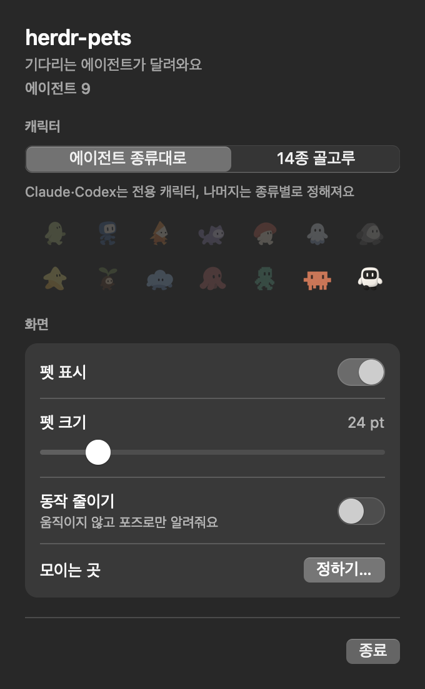

# herdr-pets

[English](README.md) | 한국어


Herdr 에이전트마다 macOS 화면에 펫이 나타나고, 에이전트가 block되면 커서 옆으로 달려와 알려 줍니다.

## 빠른 시작

필요한 것:

- macOS
- [Herdr](https://github.com/ogulcancelik/herdr) 0.9.3 이상
- Xcode Command Line Tools (설치할 때 Swift로 앱을 빌드합니다)

```sh
herdr plugin install hmu332233/herdr-pets
```

설치 후 에이전트 상태가 처음 바뀌면 Herdr가 앱을 실행하고 펫이 나타납니다.
Herdr 서버를 다시 시작할 때도 앱이 자동으로 실행됩니다.

메뉴 막대에는 펫 아이콘이 표시되며, 아이콘을 누르면 설정 패널이 열립니다.

## 동작 방식


| Herdr 상태 | 펫 |
| --- | --- |
| `blocked` | 커서 옆으로 달려와 **!** 를 띄우고 손을 흔듭니다 |
| `working` | 돌아다닙니다 |
| `done` | 축하하고 **✓** 를 띄웁니다 |
| `idle`, `unknown` | 쉽니다 |

herdr-pets는 Herdr의 에이전트 상태, 패널 이름, 작업 폴더를 읽습니다.
펫은 클릭이나 포커스를 가로채지 않습니다.

## 설정

메뉴 막대 아이콘으로 여는 설정 패널에서는 맨 위에 전체 에이전트 수와 block된 에이전트 수가 표시됩니다.



| 설정 | 설명 |
| --- | --- |
| **캐릭터: 에이전트별** | Claude와 Codex는 전용 캐릭터를 사용합니다. 다른 종류는 고정된 캐릭터를 유지합니다. 규칙은 적용하지 않습니다 |
| **캐릭터: 무작위** | 각 패널은 내장 캐릭터 14종 중 하나를 유지합니다 |
| **캐릭터: 마을** | 각 패널은 내장 또는 유효한 커스텀 펫을 유지합니다. 규칙은 적용하지 않습니다 |
| **캐릭터: 직접 설정** | 처음 일치하는 규칙을 적용합니다. 기본값입니다 |
| **펫 표시** | 펫을 표시하거나 숨깁니다 |
| **최대 펫 수** | 10마리부터 60마리까지 표시합니다. 기본값은 20마리이며 5마리씩 조절합니다 |
| **커스텀 펫 크기** | 커스텀 이미지 크기를 100%부터 200%까지 조절합니다. 기본값은 130%이며 10씩 조절합니다 |
| **펫 크기** | 펫 크기를 16–72 pt 사이에서 조절하며, **!** 와 **✓** 크기는 그대로 유지됩니다 |
| **동작 줄이기** | 펫이 포즈로만 상태를 알리도록 움직임을 줄이며, macOS의 동작 줄이기 설정도 따릅니다 |
| **모이는 곳 → 정하기…** | 반투명 창을 원하는 위치로 옮기고 크기를 조절한 뒤 닫으면 위치와 크기가 저장됩니다 |
| **모니터** | 모니터가 2대 이상일 때 펫을 보여 줄 모니터를 고르며, 모이는 곳도 그 모니터의 같은 자리로 옮겨집니다 |
| **언어** | 기본값은 macOS 언어이며, 한국어나 English로 바꿀 수 있습니다 |
| **종료** | 앱을 종료합니다 |

설정은 플러그인 설정 폴더에 저장되며, 아래 명령으로 폴더 위치를 확인할 수 있습니다.

```sh
herdr plugin config-dir dev.minung.herdr-pets
```

## 역할별 펫

사용자 이미지와 `rules.json`은 `$XDG_CONFIG_HOME/herdr/pets`에 둡니다. XDG가 없으면 `~/.config/herdr/pets`를 사용합니다.
`HERDR_PETS_DIR`로 폴더를 바꿀 수 있습니다.
규칙은 순서가 있는 JSON 목록입니다. 처음 일치하는 규칙을 사용합니다:

```json
[
  {"role": ["researcher", "explorer"], "cwd": "~/projects/", "pet": "sample"},
  {"role": "reviewer", "agent": "codex", "pet": "generic"}
]
```

각 선택 조건에는 문자열 하나나 문자열 목록을 사용할 수 있습니다.
`role`은 패널 이름의 첫 단어를 대소문자 구분 없이 비교합니다. 맨 앞에 표시용 이모지 하나를 둘 수 있습니다.
`agent`는 에이전트 종류와 정확히 일치해야 합니다.
`cwd`는 폴더 경계에서 경로 접두사를 비교합니다. 맨 앞의 `~`는 로컬 홈 폴더로 바뀝니다.
규칙의 모든 조건이 일치해야 합니다.

| `pet` 값 | 선택 |
| --- | --- |
| `"agent"` | **에이전트별** 설정 |
| `"generic"` | 일반 캐릭터 12종 중 하나. 각 펫 키마다 고정됩니다 |
| `"cat"` 같은 내장 이름 | 해당 내장 캐릭터 |
| `"sample"` 같은 사용자 ID | 해당 ID의 하위 폴더에 있는 이미지. 내장 이름보다 사용자 이미지가 우선합니다 |

각 사용자 폴더에는 `pet.json`과 PNG 또는 WebP 시트가 필요합니다:

```json
{"id":"sample","displayName":"Sample","spriteVersionNumber":2,"spritesheetPath":"spritesheet.webp","customSizeShare":0.5}
```

`customSizeShare`는 선택 사항입니다. 이 펫에 적용할 **커스텀 펫 크기** 증가분의 비율을 정합니다.
기본값은 1입니다. 로더는 숫자를 0...1 범위로 제한합니다.
숫자가 아닌 값은 1을 사용합니다. 펫은 계속 로드되며, 해당 파일의 경고는 한 번만 기록합니다.
실제 비율은 `100 + (customPetSize - 100) * customSizeShare`입니다.
예를 들어, 비율이 0.5인 `sample`은 설정이 130%일 때 115%, 200%일 때 150%를 사용합니다.
비율이 0이면 펫은 100%를 유지합니다. 내장 펫은 이 키를 사용하지 않습니다.

Codex v2 시트를 사용합니다. 크기는 1536 x 2288픽셀이며, 192 x 208픽셀 셀을 8열과 11행으로 배치합니다.
쓰지 않는 셀은 투명하게 둡니다. 로더는 각 행의 프레임 한도 안에서 알파 채널로 프레임 수를 셉니다.
작업은 7행, 대기는 6행, 축하는 4행, 휴식은 0행을 사용합니다.
모든 프레임은 하나의 자르기 영역을 공유합니다. **커스텀 펫 크기**는 커스텀 프레임 크기를 조절합니다. **펫 크기**는 모든 펫 크기를 조절합니다.
로더는 Retina 화면에서 최대 펫 크기의 200%에 맞춰 커스텀 이미지를 한 번 디코딩합니다.

**캐릭터**에는 **에이전트별**, **무작위**, **마을**, **직접 설정**의 네 모드가 있습니다.
**직접 설정**은 위 규칙을 적용합니다. 일치하는 규칙이 없는 패널은 **에이전트별**을 사용합니다.
**무작위**는 폴링과 재시작 후에도 각 패널의 내장 펫을 유지합니다.
**마을**은 규칙이 없는 폴더도 포함하여 모든 유효한 커스텀 폴더를 사용합니다.
펫 키와 후보 ID로 각 후보의 점수를 계산합니다.
후보를 추가하거나 제거하면 최고 점수 후보가 바뀌는 패널만 바뀝니다.
관계없는 커스텀 펫의 오류는 다른 선택에 영향을 주지 않습니다.
유효한 커스텀 이미지가 없어도 **마을**은 내장 후보의 점수를 계산합니다. 선택은 **무작위**와 다를 수 있습니다.
규칙이 없으면 **직접 설정**은 **에이전트별**과 같습니다.
갤러리는 내장 펫 다음에 커스텀 펫을 한 줄에 일곱 개씩 표시합니다.
현재 모드에서 나올 수 없는 펫은 흐리게 표시합니다. 커스텀 툴팁은 `displayName`을 표시합니다.
**커스텀 펫 크기**의 기본값은 130%입니다. 범위는 100%부터 200%까지이며 10씩 조절합니다.
이전 설정에서 역할별 펫이 켜져 있거나 없으면 **직접 설정**으로 이전합니다.
역할별 펫이 꺼져 있으면 14종 골고루는 **무작위**로 이전합니다. 다른 선택은 **에이전트별**로 이전합니다.
**최대 펫 수**는 펫 한도를 10마리부터 60마리까지 정합니다. 기본값은 20마리이며 5마리씩 조절합니다.
**직접 설정** 모드에서 규칙이나 이미지가 없거나 잘못되면 **에이전트별**을 사용합니다. 각 파일의 오류는 한 번만 기록합니다.
앱은 시작할 때 이미지를 읽습니다. **직접 설정** 모드만 규칙을 읽습니다. 변경된 파일은 최대 60초마다 확인합니다.

## 끄기와 제거

메뉴 막대에서 앱을 종료해도 다음에 에이전트 상태가 바뀌면 플러그인이 앱을 다시 실행합니다.
플러그인을 켜 둔 채 펫만 끄려면 `stop`, 다시 켜려면 `start` 액션을 사용합니다.

```sh
herdr plugin action invoke stop --plugin dev.minung.herdr-pets
herdr plugin action invoke start --plugin dev.minung.herdr-pets
```

플러그인까지 끄려면 `disable`로 비활성화한 뒤 메뉴 막대에서 앱을 종료합니다.

```sh
herdr plugin disable dev.minung.herdr-pets    # 제거하려면: herdr plugin uninstall dev.minung.herdr-pets
```

플러그인을 업데이트하거나 제거한 뒤에도 실행 중인 앱은 메뉴 막대에서 직접 종료해야 합니다.
Herdr 서버가 꺼지면 앱도 30초쯤 뒤에 스스로 종료됩니다.

## 문제 해결

펫이 나타나지 않으면 먼저 플러그인 상태와 최근 실행 기록을 확인합니다.

```sh
herdr plugin list --plugin dev.minung.herdr-pets
herdr plugin log list --plugin dev.minung.herdr-pets --limit 20
```

- 설치 직후에는 에이전트 상태가 한 번 바뀌어야 펫이 나타납니다.
- 실행 기록에 종료 코드 1이 남아 있다면 `bin/pets`가 빌드되지 않은 상태입니다.
  `xcode-select --install`로 Xcode Command Line Tools를 설치한 뒤 플러그인을 다시 설치하면 됩니다.
- 앱은 한 번에 하나만 실행되므로 Herdr 세션을 여러 개 쓰더라도 먼저 앱을 실행한 세션의 펫만 보입니다.

## 개발

```sh
mkdir -p bin
swiftc -O -swift-version 5 src/*.swift -o bin/pets
./bin/pets --self-test
```

Herdr는 link한 플러그인을 빌드해 주지 않으므로, 로컬에서 고친 코드를 연결하려면 먼저 빌드한 뒤 아래 명령으로 link합니다.

```sh
herdr plugin link .
```

앱을 직접 실행할 수도 있습니다.

| 명령 | 설명 |
| --- | --- |
| `./bin/pets` | 실행 중인 Herdr 에이전트의 펫을 보여 줍니다 |
| `./bin/pets --demo` | Herdr 없이 14종을 모두 보여 주며, 12초마다 상태가 바뀝니다 |
| `./bin/pets --self-test` | 창을 띄우지 않고 이미지, 캐릭터 배정, 움직임을 검사합니다 |
| `./bin/pets --export-frames <directory>` | 애니메이션이 떨리지 않는지 확인할 수 있게 프레임 이미지를 내보냅니다 |

앱을 직접 실행할 때는 `PATH`나 `HERDR_BIN_PATH`에서 `herdr`를 찾고, 설정을 프로젝트 폴더의 `pets-preferences.json`에 저장합니다.

### 캐릭터 이미지

캐릭터 이미지는 모두 투명 PNG로, 같은 폭의 칸에 포즈나 프레임을 가로로 나란히 배치합니다.

| 파일 | 내용 |
| --- | --- |
| `assets/sheets/<kind>.png` | 포즈 4개: working, blocked, celebrate, resting |
| `assets/frames/<kind>-<pose>.png` | 한 포즈의 애니메이션(선택). working과 celebrate는 4장, blocked와 resting은 2장 |
| `assets/sheets/manifest.json` | 이미지를 만든 방법과 프롬프트 |
| `assets/menubar-icon.png` | 메뉴 막대 아이콘 |

애니메이션 파일이 없으면 시트에 있는 포즈를 그대로 사용합니다. 각 프레임은 움직일 때 떨리지 않도록 발 위치와 몸의 가로 중심을 기준으로 맞춥니다.

버그 제보와 풀 리퀘스트를 환영합니다.

Claude와 Codex 캐릭터는 팬 아트이며, 이 프로젝트는 Anthropic, OpenAI와 관련이 없습니다.
