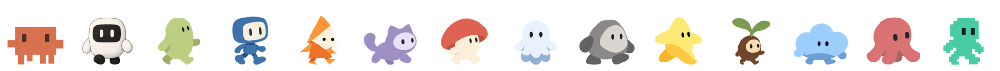
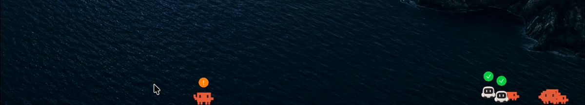
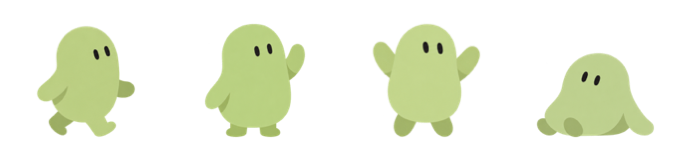
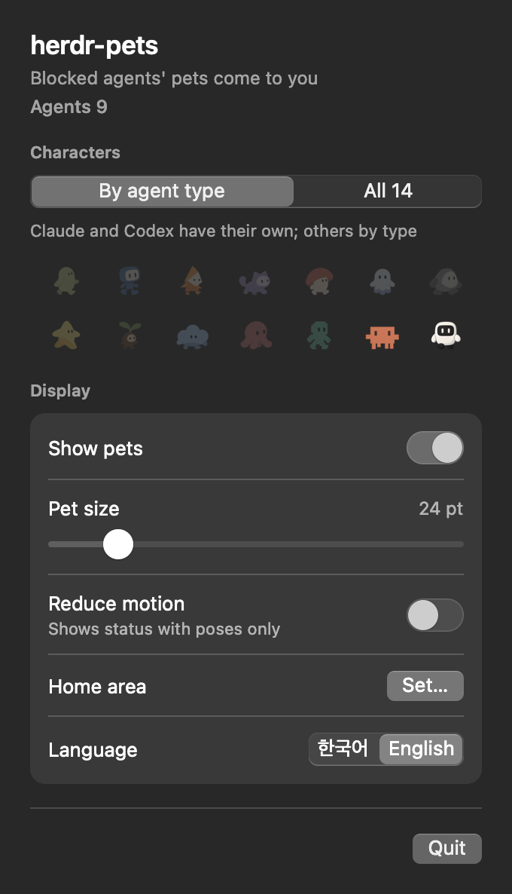

# herdr-pets

English | [한국어](README.ko.md)

This is the [aboynamedcrow fork](https://github.com/aboynamedcrow/herdr-pets) of [hmu332233/herdr-pets](https://github.com/hmu332233/herdr-pets).





Each Herdr agent gets a pet on your macOS desktop that runs to your pointer to let you know when the agent is blocked.

## Quick start

Requirements:

- macOS
- [Herdr](https://github.com/ogulcancelik/herdr) 0.9.3 or later
- Xcode Command Line Tools (the app is built with Swift on install)

```sh
herdr plugin install aboynamedcrow/herdr-pets
```

After installation, Herdr starts the app and the pets appear when an agent first changes status.
The app also starts automatically when the Herdr server restarts.

The menu bar shows a pet icon. Click it to open the settings panel.

## How it works



| Herdr status | Pet |
| --- | --- |
| `blocked` | Runs to your pointer, shows **!**, and waves |
| `working` | Wanders around |
| `done` | Celebrates and shows **✓** |
| `idle`, `unknown` | Rests |

herdr-pets reads only agent status from Herdr, and the pets never block clicks or take focus.

## Machines

Pets show agents from Local and every enabled machine in Herdr's saved machine list.
Local refreshes every 2 seconds. Other machines refresh every 6 seconds.
The app reads the machine list at startup and every 60 seconds.
Machine IDs keep pets stable when labels change.
If a machine poll fails, its pets stay for 60 seconds after the first failure.
They disappear after that hold and return when a poll succeeds.
Only Local failures count toward the app's automatic exit.
Turn **Other machines** off for Local only. This stops new remote calls and removes remote pets.
The app still shows up to 20 pets, with blocked agents first.

## Settings

The settings panel, opened from the menu bar icon, shows the total number of agents and the number of blocked agents at the top.



| Setting | Description |
| --- | --- |
| **By agent type** | Claude and Codex get their own characters. Other agents get a fixed character per agent type |
| **All 14** | Each agent gets one of the 14 characters |
| **Show pets** | Show or hide the pets |
| **Other machines** | Show agents from enabled saved machines. On by default |
| **Pet size** | Adjust pet size from 16–72 pt while **!** and **✓** stay the same size |
| **Reduce motion** | Pets show status through poses without moving, and also follow the macOS Reduce Motion setting |
| **Home area → Set…** | Move and resize the translucent window, then close it to save its position and size |
| **Monitor** | With two or more monitors, choose which one shows the pets. The home area moves to the same spot on that monitor |
| **Language** | Defaults to the macOS language. Switch to 한국어 or English |
| **Quit** | Quit the app |

Settings are saved in the plugin config folder, which you can locate with this command:

```sh
herdr plugin config-dir dev.minung.herdr-pets
```

## Turn off or uninstall

If you quit the app from the menu bar, the plugin starts it again the next time an agent changes status. Use the `stop` action to turn off the pets and `start` to bring them back while keeping the plugin enabled.

```sh
herdr plugin action invoke stop --plugin dev.minung.herdr-pets
herdr plugin action invoke start --plugin dev.minung.herdr-pets
```

To turn off the plugin as well, use `disable`, then quit the app from the menu bar.

```sh
herdr plugin disable dev.minung.herdr-pets    # to remove: herdr plugin uninstall dev.minung.herdr-pets
```

After you update or uninstall the plugin, quit the running app from the menu bar as well.
The app quits by itself about 30 seconds after the Herdr server stops.

## Troubleshooting

If no pets appear, start by checking the plugin status and recent run logs.

```sh
herdr plugin list --plugin dev.minung.herdr-pets
herdr plugin log list --plugin dev.minung.herdr-pets --limit 20
```

- After installation, an agent must change status before the pets appear.
- If a run shows exit code 1, `bin/pets` was not built.
  Install Xcode Command Line Tools with `xcode-select --install`, then reinstall the plugin.
- Only one instance of the app runs at a time. With multiple Local Herdr sessions, it reads the session that started it first.

## Development

```sh
mkdir -p bin
swiftc -O -swift-version 5 src/*.swift -o bin/pets
./bin/pets --self-test
```

Herdr does not build linked plugins, so build your local changes first, then link the project with this command:

```sh
herdr plugin link .
```

You can also run the app directly.

| Command | Description |
| --- | --- |
| `./bin/pets` | Show pets for running Herdr agents |
| `./bin/pets --demo` | Show all 14 characters without Herdr, changing their status every 12 seconds |
| `./bin/pets --self-test` | Check images, characters, movement, and machine polling with fake fetchers and a clock |
| `./bin/pets --export-frames <directory>` | Export frame images to check that animations do not jitter |

When run directly, the app finds `herdr` through `PATH` or `HERDR_BIN_PATH` and saves settings in `pets-preferences.json` in the project folder.

### Character images

Character images are transparent PNGs, with poses or frames arranged side by side in equal-width cells.

| File | Contents |
| --- | --- |
| `assets/sheets/<kind>.png` | Four poses: working, blocked, celebrate, resting |
| `assets/frames/<kind>-<pose>.png` | Optional animation for one pose: 4 frames for working and celebrate, 2 for blocked and resting |
| `assets/sheets/manifest.json` | How the images were made, with prompts |
| `assets/menubar-icon.png` | Menu bar icon |

If no animation file is available, the pet uses the pose from the sheet. Align each frame by the feet and the horizontal center of the body to prevent jitter during animation.

Bug reports and pull requests are welcome.

The Claude and Codex characters are fan art, and this project is not affiliated with Anthropic or OpenAI.
